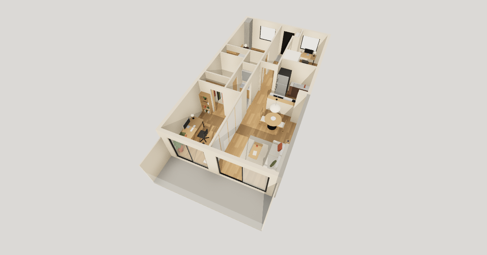

# My Home

自宅兼仕事場の間取りを再現した、歩いて回れる 3D モデルルーム。

**https://home.chiji.tech**



## 操作

| | パソコン | スマホ |
|---|---|---|
| 俯瞰 | ドラッグで回す | ドラッグで回す |
| その場に立つ | 床をクリック | 床をタップ |
| 見回す | マウスを動かす | ドラッグ |
| 歩く | WASD / 矢印キー | 床をタップ |
| ドアや窓の開閉 | 向いて E | 向いて「開ける」をタップ |
| メニューに戻る | Esc | 常に表示 |

俯瞰でも、ドアや窓を押すと開閉する。右上のボタンで昼と夜を切り替える。

## つくり

- 間取り・家具・素材は `src/plan/` のデータで、描画も当たり判定も開閉の対象もそこから導く。壁の座標を別々に持たない。
- 家具は箱・円柱・角丸の箱だけで組んでいて、外部の 3D モデルやテクスチャは使っていない。
- 当たり判定（`src/plan/collision.ts`）は three にも React にも依らない純粋関数。
- 影は動くものがあるときだけ描き直す。

React Three Fiber / drei / postprocessing、Vite、TypeScript。Cloudflare Workers の Static Assets で配信する（Worker のコードはない）。

## 開発

```bash
pnpm install
pnpm dev
```

- `pnpm build`：型を確かめて `dist/` に書き出す
- `pnpm preview`：書き出したものを `wrangler dev` で本番と同じ配信の仕方で見る
- `pnpm exec wrangler deploy`：公開する

## ライセンス

[MIT](LICENSE)
